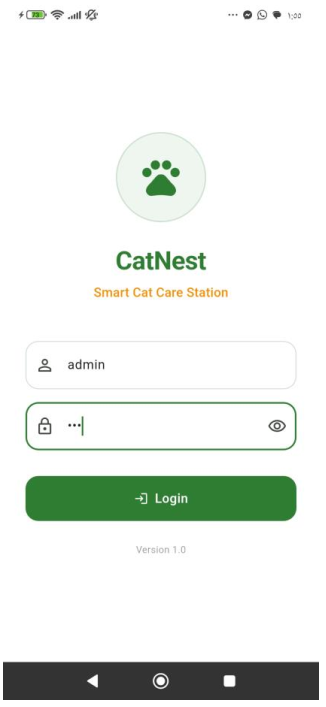
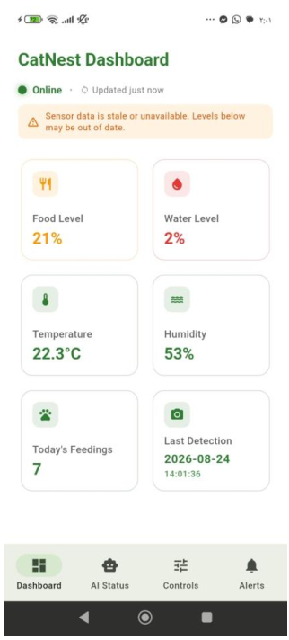
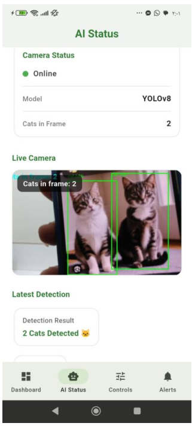
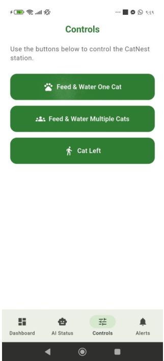
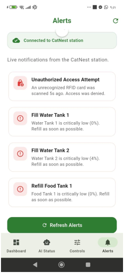

# 🐱 CatNest

**CatNest** is a Flutter companion app for a smart cat care station powered by a Raspberry Pi and an Arduino. It lets you monitor the station's camera, sensors, and alerts, and trigger feeding and watering commands, all from your phone.

---

## 📖 About / Purpose

Keeping cats fed, hydrated, and safe while you are away is hard to verify. CatNest connects to the station's Raspberry Pi over your local network and gives cat owners a single place to:

- See whether the station, camera, and Arduino are online.
- Check food and water tank levels, temperature, and humidity.
- Watch a live camera feed with AI-based cat detection.
- Send manual feeding and watering commands.
- Get notified about problems such as low tanks, offline hardware, or unauthorized access attempts.

It is intended for cat owners using the CatNest hardware station. The app is only a client: the Raspberry Pi backend that exposes the REST API is **not** part of this repository.

---

## ✨ Features

### 🔐 Login
- Login screen with username and password fields and a show/hide password toggle.
- The check is hardcoded in `lib/screens/login_screen.dart` and is for demo purposes only. There is no real authentication.
- Demo login: username `demo`, password `demo1234`.

### 📊 Dashboard
- Online/offline status of the station, with an "updated X ago" indicator.
- Auto-refresh every 3 seconds, plus pull-to-refresh.
- Metric cards for:
  - Food level (average of two tanks)
  - Water level (average of two tanks)
  - Temperature
  - Humidity
  - Today's feedings
  - Last cat detection time
- Color-coded severity (green, orange, red, blue) based on thresholds.
- Warning banner when sensor data is stale or unavailable.

### 🤖 AI Status
- Camera online/offline status, model name (defaults to `YOLOv8`), and cats in frame.
- Live MJPEG camera stream with a "cats in frame" overlay.
- Latest detection details: result, confidence, detected object, and detection time.
- Polls every second, with manual refresh and pull-to-refresh.

### 🎛️ Controls
Manual commands sent to the station:
- **Feed & Water One Cat** (`CAT1`)
- **Feed & Water Multiple Cats** (`CAT2`)
- **Cat Left** (`LEFT`)

Success or failure is shown in a snackbar.

### 🔔 Alerts
Alerts are generated in the app from the live station data (refreshed every 3 seconds):
- Station offline, camera offline, Arduino offline
- Cat detected / multiple cats detected (with confidence)
- Unauthorized RFID access attempt
- Non-cat animal detected near the feeder
- Feeding session running unusually long
- Temperature too cold / too hot
- Sensor data unavailable and per-sensor read errors
- Low and critically low levels for each of the 2 water tanks and 2 food tanks
- Rain detected (umbrella deployed automatically)

---

## 📱 Screenshots

<table align="center">
  <tr>
    <td align="center">
      <br />
      <b>Login</b>
    </td>
    <td align="center">
      <br />
      <b>Dashboard</b>
    </td>
    <td align="center">
      <br />
      <b>AI Status</b>
    </td>
  </tr>
  <tr>
    <td align="center">
      <br />
      <b>Controls</b>
    </td>
    <td align="center">
      <br />
      <b>Alerts</b>
    </td>
    <td></td>
  </tr>
</table>

---

## 🛠️ Tech Stack

| Area | Technology |
| --- | --- |
| Framework | [Flutter](https://flutter.dev) (Material 3 `NavigationBar`) |
| Language | [Dart](https://dart.dev) (SDK `^3.11.5`) |
| Networking | [`http`](https://pub.dev/packages/http) `^0.13.6` for REST calls |
| Live video | [`flutter_mjpeg`](https://pub.dev/packages/flutter_mjpeg) `^2.0.4` for the MJPEG camera stream |
| Icons | `cupertino_icons` |
| Linting | `flutter_lints` |
| State management | Built-in `StatefulWidget` / `setState` with `Timer.periodic` polling (no external state-management package) |
| Backend | External Raspberry Pi HTTP API (not included in this repo) |

**Station API endpoints used by the app:**

| Method | Endpoint | Purpose |
| --- | --- | --- |
| `GET` | `/api/ai/status` | Camera, Arduino, and AI detection status |
| `GET` | `/api/sensors/status` | Tank levels, temperature, humidity, feedings, rain |
| `GET` | `/api/security/status` | Last RFID access event |
| `GET` | `/api/ai/stream` | Live MJPEG stream |
| `GET` | `/api/ai/frame` | Single camera frame (URL helper in `ApiService`) |
| `POST` | `/api/control` | Send a command (`{"command": "CAT1"}`) |

---

## 📁 Project Structure

```text
lib/
├── main.dart            # App entry point
├── app.dart             # MaterialApp, theme, and named routes
├── config/              # api_config.dart: station base URL and request timeouts
├── models/              # AiStatus, SensorStatus, SecurityStatus (JSON parsing + offline defaults)
├── services/            # api_service.dart: all HTTP calls used by the screens
│                        # catnest_api.dart: older helper, not used by the current screens
├── screens/             # login, main_shell (bottom navigation), dashboard, ai_status, controls, alerts
├── theme/               # app_theme.dart: app-wide light theme
└── widgets/             # status_card.dart, custom_button.dart (reusable widgets, currently unused)
```

---

## 🚀 Getting Started

### Prerequisites

- [Flutter SDK](https://docs.flutter.dev/get-started/install) with Dart `^3.11.5`
- An IDE such as Android Studio or VS Code with the Flutter plugin
- A connected device or emulator
- A running **CatNest Raspberry Pi backend** that exposes the endpoints listed above, reachable from your device on the same network

### Installation

```bash
git clone <repo-url>
cd catnest
flutter pub get
flutter run
```

### ⚙️ Extra setup

There is no Firebase, `.env` file, or API key. The only required configuration is the station address:

1. Open `lib/config/api_config.dart`.
2. Change this to your Raspberry Pi's IP address: replace `YOUR_PI_IP` in `baseUrl` (`http://YOUR_PI_IP:5000`) with the Pi's IP, keeping the port.
3. Make sure your phone or emulator is on the same network as the Pi.

> 💡 Give the Pi a static or reserved IP on your router so the address does not change between sessions.

The station is served over plain HTTP, so Android cleartext traffic is enabled in `android/app/src/main/AndroidManifest.xml`. Other platforms may need their own cleartext/HTTP permissions.

---

## 🖥️ Platforms

The project contains Flutter platform folders for **Android, iOS, web, Windows, macOS, and Linux**. Development and testing so far has been on **Android** (the repo has Android debug build output). The other platforms have not been verified.

---

## 🤝 Contributing / License

Contributions are welcome. Fork the repository, create a feature branch, and open a pull request describing your changes.

No license file is included yet. Add a `LICENSE` file to define how this project may be used.
